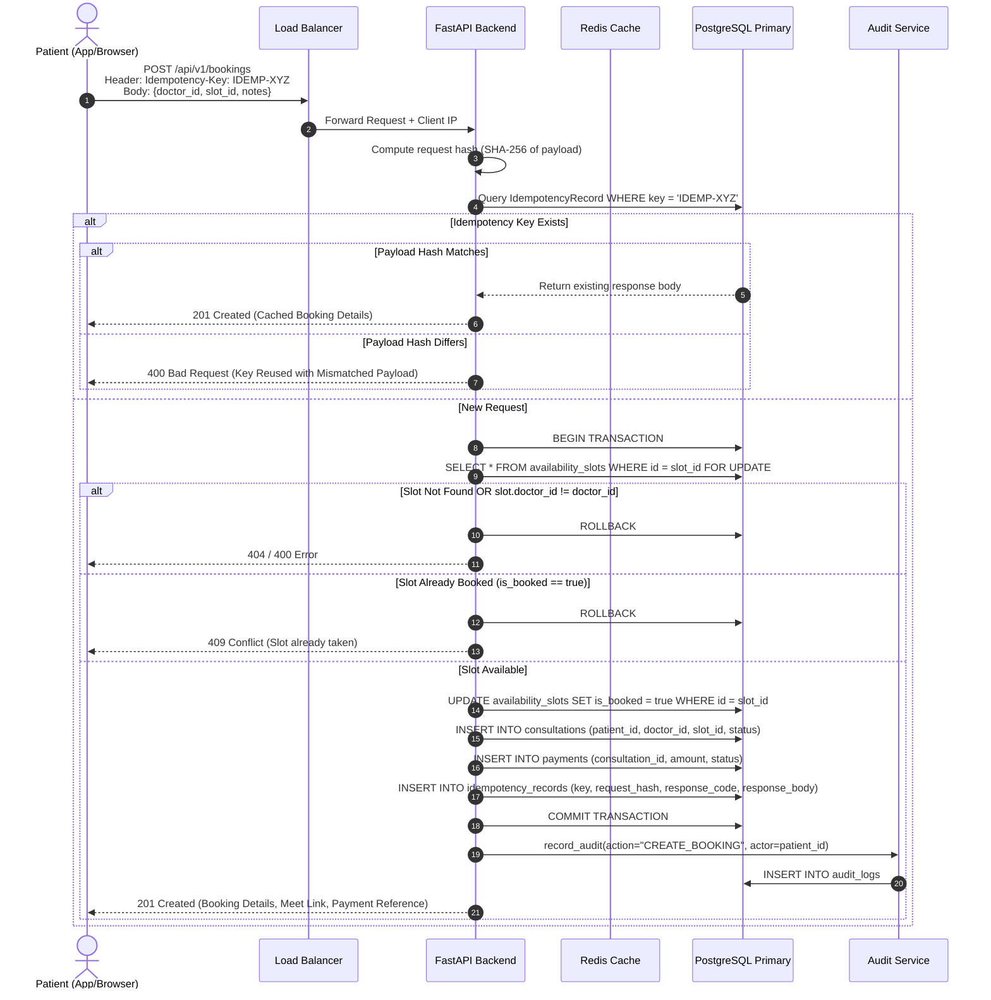

# Booking Flow Sequence Diagram

The diagram below details the sequence of events during appointment booking, illustrating concurrency control, database row locking, idempotency record checking, and audit logging.

