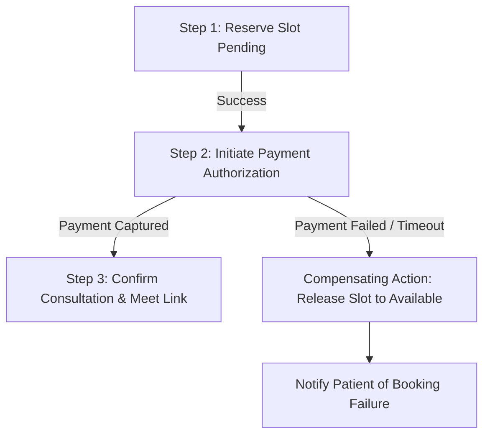

# Reliability, Scalability & Disaster Recovery Strategy

## 1. Retry & Backoff Strategies
Transient network failures and database deadlock collisions must not cause user-facing errors.

### Implementation Guidelines
- **Exponential Backoff with Full Jitter:**
  ```python
  sleep_time = min(max_backoff, base_backoff * (2 ** attempt)) + random.uniform(0, jitter)
  ```
- **Idempotent Requests Only:** Retries are strictly permitted on safe read operations (GET) or POST requests accompanied by an `Idempotency-Key`.
- **Circuit Breaker:** If downstream dependencies (such as external SMS/Email or Redis) fail 5 consecutive times within a 30-second window, the circuit opens for 15 seconds to prevent cascading resource starvation.

---

## 2. Data Partitioning Strategy (100k Daily Consultations)
Over 1 year, 100,000 daily consultations produce 36.5 million records in `consultations`, `availability_slots`, and `audit_logs`.

### Partitioning Plan
1. **`consultations` Table:**
   - **Strategy:** Range partitioning by `created_at` (monthly partitions: `consultations_2026_10`, `consultations_2026_11`, etc.).
   - **Advantage:** Queries filtering recent consultations scan only the relevant partition, keeping working sets small and indexes compact in memory.
2. **`audit_logs` Table:**
   - **Strategy:** Range partitioning by month with automated archival. Partitions older than 180 days are transitioned to Amazon S3 Glacier storage in Parquet format.
3. **`availability_slots` Table:**
   - **Strategy:** Partitioning by doctor region/timezone or list partitioning by current vs past slots, running a daily vacuum and cleanup worker.

---

## 3. Caching & Concurrency Handling

### Redis Caching Architecture
- **Doctor Catalog Cache:** Doctor details, ratings, and bios cached with a 15-minute TTL; invalidated on profile updates.
- **Doctor Slots Cache:** Available slot IDs cached with a 30-second TTL.
- **Cache-Aside Pattern:** Applications read from cache first; on a miss, data is retrieved from PostgreSQL and written back to Redis.

### Concurrency Protection
- **Pessimistic Locking (`SELECT FOR UPDATE`):** Applied on the specific `availability_slots` row inside the reservation transaction.
- **Database Level Constraint:** `UNIQUE(doctor_id, start_time)` ensures physical uniqueness even if two workers attempt concurrent slot insertions.
- **Row-Version Optimistic Locking (Alternative for High-Throughput Reads):** Can be used on user profiles with a `version` column.

---

## 4. Transaction Management & Saga Pattern

When booking and payment operations span multiple subsystems, a distributed transaction or Saga orchestration pattern ensures eventual consistency:



- In this MVP, all atomic steps occur within a single ACID transaction in PostgreSQL.
- In distributed microservice deployments, the Orchestrator initiates compensating transactions (releasing the slot, issuing a refund) if a downstream step fails.

---

## 5. Backup & Disaster Recovery (DR) Strategy

### RTO & RPO Targets
- **Recovery Point Objective (RPO):** < 5 minutes (maximum acceptable data loss).
- **Recovery Time Objective (RTO):** < 30 minutes (time to restore service after catastrophic failure).

### Backup Architecture
1. **Automated Continuous Backups:** AWS RDS Point-In-Time Restore (PITR) with transaction logs (WAL) archived every 5 minutes to S3.
2. **Daily Multi-Region Snapshots:** Automated nightly snapshots replicated to a secondary AWS region (e.g., from `ap-south-1` Mumbai to `ap-southeast-1` Singapore).
3. **Disaster Recovery Drills:** Automated dry-run restoration scheduled once a quarter to verify snapshot integrity and recovery playbooks.
